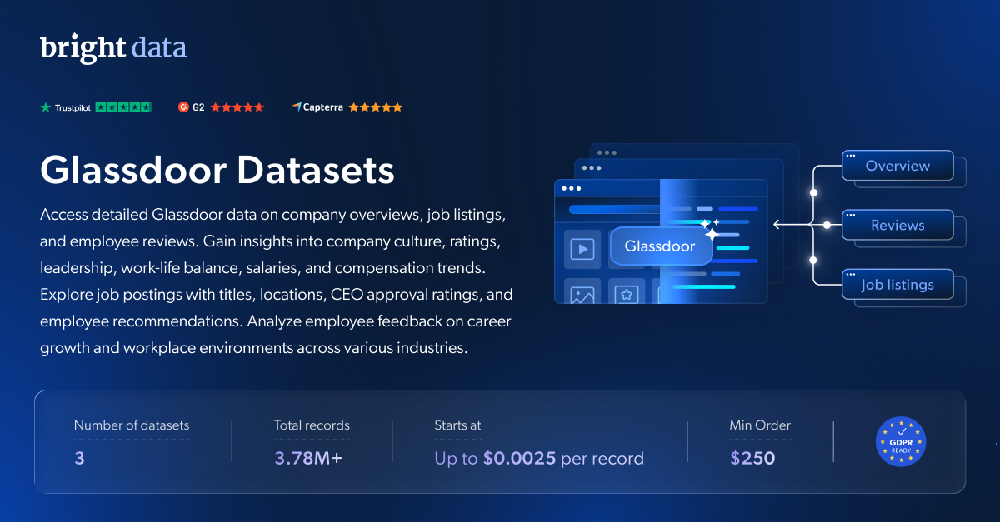

# Glassdoor-dataset-samples

<h2>包含 1001 条 Glassdoor 公司评价的样本数据集</h2>

<a href="https://www.bright.cn/products/datasets/glassdoor">
   
</a>

包含超过 1000 条公司评价的 Glassdoor 数据集样本。该数据集使用 <b>Bright Data API</b> 提取。

<h2>此免费数据集包含的数据点：</h2>

* ```overview_id```：公司概览的唯一标识符
* ```review_id```：每条评价的唯一标识符
* ```review_url```：Glassdoor 上特定评价的链接
* ```rating_date```：评价提交日期
* ```company_name```：被评价的公司名称
* ```review_pros```：评价中提到的优点
* ```review_cons```：评价中提到的缺点
* ```rating_overall```：评价者给出的总体评分
* ```summary```：评价摘要
* ```rating_work_life```：工作与生活平衡评分
* ```rating_compensation_benefits```：薪酬与福利评分
* ```rating_culture_values```：公司文化与价值观评分
* ```flags_business_outlook```：与业务前景相关的标记
* ```employee_type```：雇佣状态（例如前员工、现员工）
* ```flags_recommend_frend```：与是否推荐该公司相关的标记
* ```rating_senior_leadership```：高级领导层评分
* ```flags_ceo_approval```：与 CEO 认可度相关的标记

以及更多数据点。

这是“Glassdoor 公司评价（公开数据）”数据集的样本子集，该数据集涵盖超过 <b>21,860,000 家公司</b>。

可用的数据集文件格式：<b>JSON、NDJSON、JSON Lines、CSV 或 Parquet。文件也可选择压缩为 .gz 格式</b>。

数据集交付方式选项：<b>电子邮件、API 下载、Webhook、Amazon S3、Google Cloud Storage、Google Cloud PubSub、Microsoft Azure、Snowflake、SFTP</b>。

更新频率：<b>单次、每日、每周、每月、每季度或自定义频率</b>。

可在已提取数据点的基础上添加数据增强：<b>根据要求提供。</b>

<b>[获取完整的 Glassdoor 公司评价数据集](https://www.bright.cn/products/datasets/glassdoor)</b>。

<h2>其他可用的 Glassdoor 数据集：</h2>

*   Glassdoor 公司概览信息
*   Glassdoor 完整职位列表信息

<a href="https://www.bright.cn/products/datasets/glassdoor">
   
</a>

<h2>Glassdoor 数据集有哪些用例？</h2>

<h3>1. 竞争分析</h3>

利用企业特征数据监测公司增长、锁定关键组织和专业人士、跟踪员工流动，并更高效地增强竞争情报与分析能力。

<h3>2. 市场趋势与增长</h3>

评估公司增长和行业趋势，为数据驱动型决策提供支持。对冲基金、风险投资机构和金融公司可以利用 Glassdoor 数据集显著提升投资分析能力。

<h3>3. B2B 公司数据</h3>

将高质量的公司和员工数据集成到你的 CRM 中，并借助全面的 Glassdoor 数据集进行数据增强，从而提升潜在客户开发和销售情报能力。

<h2>面向学术研究人员和 NGO 免费开放网页爬虫工具与数据集</h2>

Bright Initiative 为顶尖院系和学术研究人员，以及致力于推动各类环境和社会事业的 NGO 与 NPO，提供 Bright Data 的 <b>[网页爬虫工具 API](https://www.bright.cn/products/web-scraper)</b> 和 <b>[即用型数据集](https://www.bright.cn/products/datasets)</b>。你可以在<b>[此处](https://brightinitiative.com)</b>提交申请。
